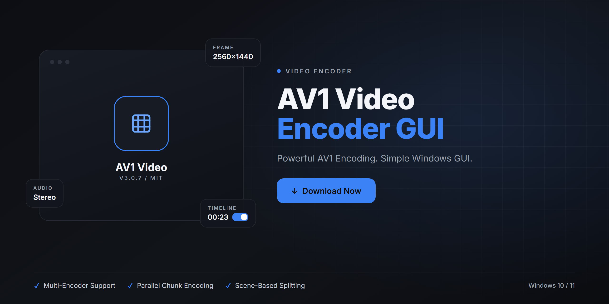
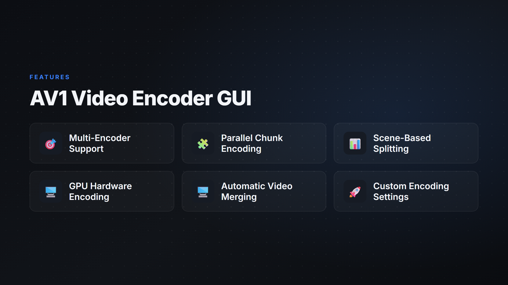

  
  
  
  
  
  

**AV1 Video Encoder GUI is a free, open-source Windows desktop application for high-quality AV1 video encoding, video compression, and format conversion.** Use powerful encoders like SVT-AV1, rav1e, aomenc, NVIDIA NVENC, and Intel Quick Sync through an intuitive graphical interface — no command line required.

## ⬇️ Installation

**Download the Windows application**

1. Open the repository's [Releases](https://github.com/Nebula4207/av1-video-encoder-gui/releases) page.
2. Download the latest release archive **`AV1 Video Encoder GUI 4.4.5.zip`**.
3. Extract the archive into a folder of your choice.
4. Keep **`AV1 Video Encoder GUI 4.4.5.exe`** and `libvlc.dll` together in that folder.
5. Double-click **`AV1 Video Encoder GUI 4.4.5.exe`** to launch the application.

## ✨ Features

- 🎬 **Multiple AV1 Encoders** — Choose between SVT-AV1, rav1e, and aomenc to balance encoding speed, compression efficiency, and video quality.
- ⚡ **Parallel Video Encoding** — Split large videos into smaller chunks and process multiple segments simultaneously to make better use of available CPU resources.
- 🎯 **Scene-Based Video Splitting** — Divide videos using scene changes or configurable equal-sized segments for flexible encoding workflows.
- 🚀 **GPU Hardware Acceleration** — Take advantage of supported NVIDIA NVENC AV1 and Intel Quick Sync AV1 hardware encoders.
- 📦 **Automatic Video Merging** — Combine successfully encoded segments into a single finished video when processing is complete.
- 🎞️ **VP9 and Legacy Codec Support** — Work with additional video encoding options, including VP9, H.264, and H.265 where supported.
- 🖥️ **User-Friendly Windows GUI** — Configure encoding workflows, select files, adjust settings, and manage jobs without memorizing terminal commands.

## 🖼️ Overview

The application brings modern video compression tools together in one Windows desktop interface.

Whether you are archiving personal video collections, preparing media for online distribution, or experimenting with AV1 compression, the graphical workflow makes advanced encoding more accessible.

### Supported Video Encoders

| Encoder | Codec | Processing |
|---|---|---|
| SVT-AV1 | AV1 | CPU |
| rav1e | AV1 | CPU |
| aomenc / libaom | AV1 | CPU |
| NVIDIA NVENC | AV1 | GPU |
| Intel Quick Sync | AV1 | GPU |
| libvpx | VP9 | CPU |
| x265 | H.265 / HEVC | CPU |
| x264 | H.264 / AVC | CPU |

*Hardware encoder availability depends on your GPU, driver version, and supported hardware. Additional codec options depend on the installed encoder binaries.*

### Why Use AV1 Video Encoding?

AV1 is a modern video compression format designed to deliver efficient compression while maintaining high visual quality.

Compared with older codecs, AV1 can help reduce storage requirements and bandwidth consumption, making it useful for:

- Video archiving and long-term storage.
- High-quality media distribution.
- Reducing video file sizes.
- Preparing videos for modern streaming workflows.
- Converting existing media libraries to AV1.
- Experimenting with different encoder quality and speed settings.

## 🚀 Usage

A typical encoding workflow takes just a few steps:

1. **Select a video** — Open the Windows application and choose the source video you want to encode.
2. **Choose an encoder** — Select SVT-AV1, rav1e, aomenc, or a supported hardware encoder.
3. **Configure encoding** — Adjust available quality, speed, and processing options to suit your requirements.
4. **Configure chunking** — Choose scene-based splitting or equal-sized segments when using parallel encoding.
5. **Start processing** — Let the application encode the individual segments using the selected workers.
6. **Merge the output** — Combine the completed segments into the final video file.

### Recommended Encoding Workflow

| Goal | Suggested approach |
|---|---|
| Balanced AV1 encoding | SVT-AV1 |
| Compression experimentation | aomenc |
| Alternative AV1 implementation | rav1e |
| GPU-accelerated AV1 | NVIDIA NVENC |
| Intel GPU AV1 encoding | Intel Quick Sync |
| VP9 video encoding | libvpx-vp9 |

Actual performance and output quality depend on the source video, encoder configuration, hardware, and selected quality settings.

### Performance Tips

- Use hardware encoding when supported GPU acceleration is a priority.
- Experiment with chunk sizes to find a suitable balance between parallelism and processing overhead.
- Avoid running more encoding workers than your system can efficiently handle.
- Keep sufficient free disk space for temporary segments and final output files.
- Test encoding settings on a short sample before processing an entire video collection.

## 🔒 Security

Your videos and encoding configuration should remain under your control.

- **No telemetry or tracking** — No advertising analytics or user activity tracking is required by the application.
- **Open-source transparency** — The source code is available for inspection, auditing, and community contributions.
- **Local processing** — Encoding is performed using the configured local encoder tools.
- **No command-line expertise required** — The graphical interface handles the ordinary encoding workflow.
- **Responsible issue reporting** — Report bugs, crashes, compatibility problems, and potential security vulnerabilities through the repository's issue reporting process.

Only obtain application releases and encoder components from sources you trust. Review third-party binaries and their licenses before using them.

## 🤝 Contributing

Contributions from the open-source video encoding community are welcome!

You can help improve the project by:

- Reporting reproducible bugs.
- Suggesting additional encoding options.
- Improving Windows compatibility.
- Testing different AV1 encoders and hardware configurations.
- Improving documentation and translations.
- Submitting code improvements and feature requests.

Please include relevant application logs, Windows version, encoder information, and reproduction steps when reporting a problem.

## 💻 System Requirements

| Component | Requirement |
|---|---|
| Operating System | Windows |
| Architecture | Compatible Windows desktop architecture |
| Storage | Additional space for source videos and encoded segments |
| CPU | Recommended for software encoding |
| GPU | Optional, for supported hardware encoding |
| Encoder binaries | Required for the selected encoding backend |

Actual system requirements vary depending on the selected encoder and video resolution.

## ❓ Frequently Asked Questions

### What is an AV1 video encoder?

An AV1 encoder converts video into the AV1 format, a modern video codec designed for efficient compression and high visual quality.

### Do I need to use the command line?

No. The application provides a graphical Windows interface for configuring and managing encoding jobs.

### Which AV1 encoders are supported?

The supported software encoders include SVT-AV1, rav1e, and aomenc. Compatible NVIDIA NVENC and Intel Quick Sync hardware encoding options are also available.

### Can I encode multiple video segments simultaneously?

Yes. The chunk-based workflow allows a video to be divided into segments and processed by multiple workers.

### What is scene-based splitting?

Scene-based splitting divides a video around detected scene changes rather than using only fixed-duration segments. This provides another way to organize parallel encoding jobs.

### Does the application support VP9?

Yes. VP9 encoding through libvpx is among the additional codec options.

### Is AV1 always faster than H.264 or H.265?

No. AV1 encoding speed depends on the encoder, quality settings, hardware, and source material. Its primary appeal is compression efficiency rather than universally faster encoding.

### Is the application free?

Yes. The project is distributed as open-source software under the MIT License.

## 🌟 Project Goals

AV1 Video Encoder GUI aims to make modern video compression accessible without sacrificing the flexibility of established encoding tools.

The project focuses on:

- Bringing popular AV1 encoding backends into one interface.
- Making parallel video processing easier to manage.
- Supporting both software and compatible hardware encoding.
- Simplifying video conversion and compression workflows.
- Providing a practical desktop experience for Windows users.

## 📄 License

This project is licensed under the **MIT License**. You are free to use, modify, distribute, and contribute to the software under its license terms.